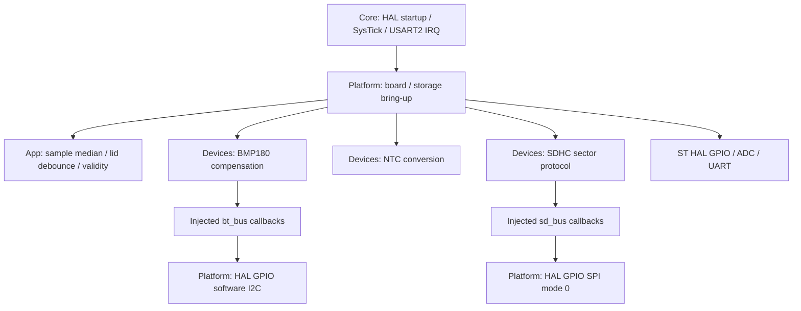

# Архітектура ЛР2

Цей опис зафіксовано для ревізії lab2. Для поточної прошивки див. [архітектуру задач ЛР3](lab3-tasks.md) і [базову лінію](baseline-lab4.md).

Core залишає clock/UART/GPIO startup, Platform зберігає всі знання про піни, HAL-хендли й періоди bring-up. Devices не включає HAL і приймає callbacks. App працює з температурами у 0.1 °C, валідністю й контактом; автомата партій немає. Автоматична перевірка tools/check_layers.py відхиляє HAL/STM32 або board.h в App/Devices. `make test` виконує її до host-тестів. Тести використовують контрольовану шину, включно з перевіркою послідовності команд SD, та незалежні температурні вектори.

Код під’єднаний до USER CODE main; власні модулі поза Core. .ioc збережений і актуалізований вручну як конфігураційний опис: CubeMX у цьому сеансі не генерував код. Його повторна генерація потребує звірки Makefile та USER CODE; здатність відтворити поточну Platform однією Generate Code не перевірена.

## Підсистема введення

NTC кожні 100 мс; BMP180 200 мс; контакт 5 мс; рядок FRAME 200 мс. ADC_MARK PA8 обрамлює HAL conversion. LID_DB PA9 показує відфільтрований контакт, PA5 = usable AND in-band. Це bring-up вимірювальної підсистеми ЛР2, не реалізація FR автомата партій ЛР3.

UART RX переривання копіює байти у кільце 128 байт, один producer/consumer, місткість 127 байт. ISR не викликає printf. Обробник foreground розбирає рядок ≤79 байт; довший відкидає до LF. counts показує byte overflow і HAL RX errors; нескінченний потік не гарантується. Команди selftest/capture повторюють ID/калібрування/ADC, nack обирає відсутню адресу 0x76, recover повертає 0x77, status/counts читають стан. sdwrite змінює лише scratch-сектор 32, sdread читає його. Журнал партій і profile/start/abort/export належать ЛР3.

## Чому програмна I²C

У початковій спробі HAL_I2C_Mem_Read на цьому Wokwi-стенді на шині були ACK адреси та D0, але завершення не відбулося. Спроба HAL Master TX/RX показала на шині 55, однак CR2/ISR після STOP зберігали стан, що призводив до стороннього звернення 00 і наступної помилки/неправильного ID. Сировина: docs/metrics/lab2/bringup-first, bringup-fixed-adc-i2c та i2c-diagnostic. Це спостережена несумісність конкретного HAL/симулятора, не доказ дефекту фізичного BMP180 чи всіх реалізацій I²C.

Виправлення ізольоване в Platform: стандартний I²C, START/repeated START/ACK/NACK/STOP через HAL GPIO. HIGH означає INPUT + pull-up, LOW — open-drain LOW. Саме release через input також дозволяє читати зовнішній рівень у цій моделі. Є timeout 10 мс очікування SCL і перевірка SDA перед START. Сигнальні записи підтверджують адреси та дані. Hardware I2C HAL більше не ввімкнений. Програмна шина займає CPU; її реальні частоти й вплив на періоди наведено в аналізі, а в ЛР3 це окреме джерело блокувань для вимірювання. Піни зберігають можливість SPI1/I2C1 без перепідключення стенда, але AF зараз не обрані.

## Сховище

SDHC, SPI mode 0 через HAL GPIO, один статичний сектор 512 байт; CMD0, CMD8, CMD55/ACMD41, CMD58, CMD24, CMD17. CRC команд 0/8 правильний; CRC mode вимкнений за default SPI, дані перевіряються byte-for-byte. Це не файлове сховище і не готовий журнал з CRC/atomic commit. ЛР3 має додати формат запису, CRC32, recovery і power-loss. Підготовчий bring-up є реальною SD-записом, а не RAM або delay.

## Залежності

CMSIS/HAL успадковані з дозволеного SP-Boilerplate (HAL 1.0.1), вихідний STM32Cube FW_C0 1.0.1 у .ioc. Додані ADC/ADCEx/LL_ADC — офіційний ST stm32c0xx-hal-driver v1.0.1, git 997b11e515c1792c32a4d1c52eb74cd75598dd9a. Усі файли vendored; SHA-256 у docs/dependencies.sha256. Власні драйвери BMP180/NTC/SD та App написані для BatchTherm; бібліотеки Adafruit/Arduino не використовуються. Увімкнено HAL GPIO/ADC/UART/CORTEX/RCC/FLASH/PWR/DMA: останній потрібний типам та посиланням UART/ADC HAL, фактичний DMA не застосовується і в Wokwi недоступний. Flash HAL виконує startup latency, не журнал. `-Wall -Wextra` для власного коду, `-Wno-unused-parameter` тільки для ST HAL. `-Os` потрібний для 32-KiB flash разом із SD.
